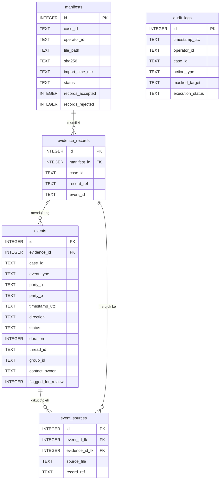

# contact-association

Alat forensik digital analisis asosiasi kontak nomor telepon seluler Indonesia,
beroperasi 100% offline berbasis SQLite, Python 3.10+, dan standar pemrosesan bukti forensik digital.

---

## Daftar Isi

1. [Instalasi](#instalasi)
2. [Prasyarat & Ketergantungan](#prasyarat--ketergantungan)
3. [Struktur Proyek](#struktur-proyek)
4. [CLI — Contoh Penggunaan](#cli--contoh-penggunaan)
   - [import](#import)
   - [candidates](#candidates)
   - [lookup](#lookup)
   - [audit](#audit)
5. [Skema Input & Profil Impor](#skema-input--profil-impor)
6. [Format Ekspor](#format-ekspor)
7. [Kategori Asosiasi Bukti](#kategori-asosiasi-bukti)
8. [Arsitektur & Skema Database](#arsitektur--skema-database)
9. [Batasan Parser](#batasan-parser)
10. [Ketentuan Forensik & Privasi](#ketentuan-forensik--privasi)
11. [Pengujian & Benchmark](#pengujian--benchmark)

---

## Instalasi

```bash
# Clone atau salin folder contact-association ke direktori kerja kasus
cd d:\TARGET

# Pastikan Python 3.10+ tersedia
python --version

# Tidak ada dependensi eksternal yang wajib.
# Semua parser (CSV, JSON, XLSX, VCF, WhatsApp TXT) menggunakan Python standard library.
# Jika openpyxl tersedia, dapat digunakan sebagai fallback XLSX; bukan keharusan.

# Jalankan langsung
python contact_association.py --help
```

---

## Prasyarat & Ketergantungan

| Komponen | Status | Keterangan |
|---|---|---|
| Python 3.10+ | **Wajib** | Standard library: `sqlite3`, `csv`, `json`, `zipfile`, `xml.etree`, `hashlib`, `re`, `argparse` |
| SQLite 3 | **Built-in** | Tersedia di Python standard library |
| openpyxl | Opsional | Hanya diperlukan jika XLSX besar dengan fitur Excel lanjutan; parser XLSX built-in sudah mencukupi untuk sebagian besar file |

> **[!IMPORTANT]**
> Semua operasi dilakukan **offline**. Tidak ada koneksi jaringan, API eksternal, scraping, atau lookup operator real-time yang terjadi pada proses apapun.

---

## Struktur Proyek

```
contact-association/
├── contact_association.py          # Titik masuk CLI
├── core/
│   ├── __init__.py
│   ├── normalizer.py               # Normalisasi & validasi nomor (+62/62/08xx)
│   ├── models.py                   # Dataclass: ManifestRecord, NormalizedEvent, AuditEntry, dll.
│   ├── db.py                       # Database SQLite, skema, indeks, audit log
│   ├── importer.py                 # Orkestrator impor berkas + SHA-256 manifest
│   ├── candidates.py               # Pencarian kandidat suffix 4-8 digit
│   ├── engine.py                   # Mesin asosiasi 5 kategori forensik
│   ├── exporter.py                 # Ekspor JSON & CSV
│   ├── time_utils.py               # Parsing timestamp, TZ, batas tanggal kalender
│   ├── xlsx_creator.py             # Generator XLSX murni Python (untuk fixture/benchmark)
│   └── parsers/
│       ├── __init__.py             # Registry parser
│       ├── base.py                 # Kelas dasar BaseParser
│       ├── csv_parser.py           # Parser CSV (CDR, SMS, Call Log)
│       ├── json_parser.py          # Parser JSON + Telegram Desktop Export
│       ├── xlsx_parser.py          # Parser XLSX (pure Python zipfile+xml)
│       ├── vcf_parser.py           # Parser vCard 2.1 / 3.0 / 4.0
│       └── whatsapp_parser.py      # Parser ekspor chat WhatsApp (.txt)
├── profiles/
│   ├── cdr_profile.json            # Profil CDR operator
│   ├── call_log_profile.json       # Profil log panggilan perangkat
│   ├── sms_profile.json            # Profil log SMS
│   ├── telegram_profile.json       # Profil ekspor Telegram JSON
│   └── backup_contacts_profile.json # Profil buku kontak backup
├── fixtures/
│   ├── sample_cdr.csv
│   ├── sample_contacts.vcf
│   ├── sample_shared_contacts.vcf
│   ├── sample_telegram.json
│   ├── sample_whatsapp_private.txt
│   ├── sample_whatsapp_group.txt
│   └── sample_workbook.xlsx
├── scripts/
│   ├── make_fixtures.py            # Pembuat fixture XLSX
│   └── benchmark.py               # Benchmark 100.000 peristiwa sintetis
└── tests/
    ├── test_normalizer.py
    ├── test_parsers.py
    ├── test_association_rules.py
    ├── test_deduplication.py
    ├── test_date_filters.py
    ├── test_masking_and_full.py
    ├── test_audit.py
    ├── test_candidates.py
    └── test_cli.py
```

---

## CLI — Contoh Penggunaan

> **[!IMPORTANT]**
> `--case-id` dan `--operator-id` adalah **wajib** di semua subperintah.
> `--operator-id` adalah identitas yang **dinyatakan sendiri oleh pengguna CLI** dan dicatat ke audit log forensik.

### `import`

Mengimpor satu berkas atau seluruh folder bukti artefak forensik.

```bash
# Impor folder berisi berbagai format dengan profil pemetaan kolom CDR
python contact_association.py import \
  --db case.sqlite \
  --case-id CASE-001 \
  --operator-id OP-01 \
  --input ./sample_evidence \
  --profile ./profiles/cdr_profile.json

# Impor satu berkas XLSX, pilih sheet "CDR_Log"
python contact_association.py import \
  --db case.sqlite \
  --case-id CASE-001 \
  --operator-id OP-01 \
  --input ./evidence/log_komunikasi.xlsx \
  --sheet CDR_Log \
  --source-device "HP Samsung Target"

# Impor buku kontak VCF dengan kepemilikan perangkat yang diketahui
python contact_association.py import \
  --db case.sqlite \
  --case-id CASE-001 \
  --operator-id OP-01 \
  --input ./evidence/contacts.vcf \
  --contact-owner 081200000012 \
  --target-basis "HP disita dari saksi A atas nama tersangka"

# Impor ulang berkas yang sama tidak akan menggandakan peristiwa (SHA-256 dicek)
python contact_association.py import \
  --db case.sqlite \
  --case-id CASE-001 \
  --operator-id OP-01 \
  --input ./evidence/sample_cdr.csv
```

**Argumen `import`:**

| Argumen | Wajib | Keterangan |
|---|---|---|
| `--db` | ✓ | Jalur berkas SQLite kasus |
| `--case-id` | ✓ | ID kasus forensik |
| `--operator-id` | ✓ | Identitas operator (dinyatakan sendiri) |
| `--input` | ✓ | Jalur berkas tunggal atau folder |
| `--profile` | — | Jalur berkas profil pemetaan kolom JSON |
| `--sheet` | — | Nama atau indeks sheet untuk XLSX (0-based jika angka) |
| `--source-device` | — | Label perangkat/sumber untuk metadata manifest |
| `--contact-owner` | — | Nomor pemilik buku kontak jika kepemilikan terbukti |
| `--target-basis` | — | Dasar pengaitan perangkat/akun dengan target |

---

### `candidates`

Mencari kandidat nomor telepon berdasarkan **suffix digit belakang (4–8 digit)**, mempertahankan nol di awal.

```bash
# Cari nomor yang berakhiran 0012 (mempertahankan leading zero)
python contact_association.py candidates \
  --db case.sqlite \
  --case-id CASE-001 \
  --operator-id OP-01 \
  --suffix 0012

# Tampilkan nomor lengkap untuk penanganan bukti internal
python contact_association.py candidates \
  --db case.sqlite \
  --case-id CASE-001 \
  --operator-id OP-01 \
  --suffix 0012 \
  --show-full

# Ekspor daftar kandidat ke JSON
python contact_association.py candidates \
  --db case.sqlite \
  --case-id CASE-001 \
  --operator-id OP-01 \
  --suffix 2222 \
  --export candidates_2222.json
```

> **[!IMPORTANT]**
> Kandidat yang dikembalikan **hanya referensi daftar**. Operator **harus** memilih nomor lengkap secara eksplisit sebelum menjalankan `lookup`. Alat ini tidak melakukan inferensi identitas otomatis.

---

### `lookup`

Analisis asosiasi kontak **satu langkah** (direct association) untuk nomor target kanonik.

```bash
# Lookup dasar
python contact_association.py lookup \
  --db case.sqlite \
  --case-id CASE-001 \
  --operator-id OP-01 \
  --target 081200000012

# Lookup dengan filter periode dan ekspor JSON
python contact_association.py lookup \
  --db case.sqlite \
  --case-id CASE-001 \
  --operator-id OP-01 \
  --target 081200000012 \
  --from 2024-01-01 \
  --to 2024-01-31 \
  --export report.json

# Lookup dengan ekspor CSV
python contact_association.py lookup \
  --db case.sqlite \
  --case-id CASE-001 \
  --operator-id OP-01 \
  --target +628120000012 \
  --export laporan.csv

# Nomor lengkap untuk penanganan bukti internal
python contact_association.py lookup \
  --db case.sqlite \
  --case-id CASE-001 \
  --operator-id OP-01 \
  --target 081200000012 \
  --show-full \
  --export report_full.json
```

**Format `--target` yang didukung:**

| Format | Contoh |
|---|---|
| Lokal `08xx` | `081200000012` |
| Internasional `+628xx` | `+628120000012` |
| Tanpa tanda plus `628xx` | `628120000012` |

**Catatan filter tanggal:**
- `--from 2024-01-01` → batas awal `2024-01-01T00:00:00`
- `--to 2024-01-31` → batas akhir inklusif `2024-01-31T23:59:59`
- Bukti **tanpa tanggal** dipisahkan dan dilaporkan sebagai `undated_records_count` saat filter aktif
- Timestamp disimpan dalam format aslinya. UTC digunakan untuk perbandingan hanya jika zona waktu diketahui

---

### `audit`

Menampilkan log audit forensik untuk seluruh aktivitas (impor, kueri, ekspor, termasuk yang gagal).

```bash
python contact_association.py audit \
  --db case.sqlite \
  --case-id CASE-001 \
  --limit 100
```

> **[!NOTE]**
> Audit log **tidak menyimpan** isi pesan atau nomor telepon lengkap. Target dicatat dalam bentuk tersamarkan.

---

## Skema Input & Profil Impor

### Pemetaan Profil (`--profile <mapping.json>`)

Profil impor adalah berkas JSON yang mendefinisikan nama kolom sumber → field internal.

```json
{
  "_description": "Profil CDR operator",
  "event_type": "CALL",
  "parser_name": "CSVParser",
  "mapping": {
    "party_a": "caller_msisdn",
    "party_b": "callee_msisdn",
    "timestamp": "call_datetime",
    "duration": "duration_sec",
    "direction": "call_direction",
    "status": "call_status",
    "event_id": "cdr_record_id"
  }
}
```

**Field pemetaan yang tersedia:**

| Field profil | Keterangan |
|---|---|
| `party_a` | Nomor asal (pemanggil / pengirim) |
| `party_b` | Nomor tujuan (penerima) |
| `timestamp` | Kolom tanggal/waktu peristiwa |
| `duration` | Durasi dalam detik |
| `direction` | Arah: INCOMING / OUTGOING |
| `status` | Status: ANSWERED / MISSED / ATTEMPTED / DELIVERED |
| `event_id` | Identifier unik peristiwa untuk deduplikasi |
| `thread_id` | ID thread percakapan |
| `group_id` | ID grup |
| `contact_name` | Nama tampilan kontak |
| `contact_owner` | Nomor pemilik buku kontak |

**Profil bawaan yang tersedia:**

| Berkas | Jenis Sumber |
|---|---|
| `profiles/cdr_profile.json` | CDR operator seluler |
| `profiles/call_log_profile.json` | Log panggilan perangkat lokal |
| `profiles/sms_profile.json` | Log SMS perangkat / operator |
| `profiles/telegram_profile.json` | Ekspor Telegram Desktop JSON |
| `profiles/backup_contacts_profile.json` | Buku kontak dari backup yang sudah diekstrak |

### Format Input yang Didukung

| Ekstensi | Format | Parser |
|---|---|---|
| `.csv` | CSV CDR, SMS log, Call log | `CSVParser` |
| `.json` | JSON generik, Telegram Desktop Export | `JSONParser` |
| `.xlsx` | Spreadsheet Excel | `XLSXParser` |
| `.vcf` | vCard 2.1 / 3.0 / 4.0 | `VCFParser` |
| `.txt` | Ekspor teks percakapan WhatsApp | `WhatsAppParser` |

---

## Format Ekspor

### JSON (`--export report.json`)

Laporan lengkap JSON memuat:
```json
{
  "_metadata": { "generated_at_utc": "...", "tool": "contact-association", ... },
  "summary": {
    "case_id": "CASE-001",
    "target": "0812****0012",
    "masked_target": "0812****0012",
    "date_filter": { "active": true, "from": "...", "to": "..." },
    "sources_analyzed": ["sample_cdr.csv"],
    "total_unique_associated_numbers": 5,
    "category_counts": { "CALL_INTERACTION": 3, "DIRECT_MESSAGE": 1, ... },
    "disclaimer": "..."
  },
  "details": {
    "CALL_INTERACTION": [
      {
        "category": "CALL_INTERACTION",
        "masked_number": "0813****2222",
        "operator_name": "Telkomsel",
        "operator_source": "inferensi prefix",
        "event_count": 4,
        "first_activity_utc": "2024-01-10T09:15:00",
        "last_activity_utc": "2024-02-05T10:00:00",
        "breakdown": { "incoming_calls": 1, "outgoing_calls": 3, ... },
        "evidence_refs": ["sample_cdr.csv#line:2"]
      }
    ]
  }
}
```

### CSV (`--export report.csv`)

Berkas CSV per-baris bukti dengan kolom:
`case_id`, `target_number`, `category`, `associated_number`, `operator`, `operator_source`,
`event_count`, `first_activity_utc`, `last_activity_utc`, `breakdown_summary`,
`evidence_references`, `disclaimer`

> **[!IMPORTANT]**
> Nomor telepon **selalu tersamarkan secara default** (`0812****0012`).
> Tambahkan `--show-full` hanya untuk penanganan bukti internal yang terotorisasi.

---

## Kategori Asosiasi Bukti

### 1. `CALL_INTERACTION`

Target dan nomor terkait tercatat sebagai **kedua pihak** pada log panggilan yang sama. Dihitung:
- Panggilan masuk (`incoming_calls`)
- Panggilan keluar (`outgoing_calls`)
- Panggilan terjawab (`answered_calls`) vs percobaan/terjawab (`attempted_or_missed_calls`)
- Waktu pertama dan terakhir

### 2. `DIRECT_MESSAGE`

Target dan nomor terkait dapat diidentifikasi sebagai **kedua pihak dalam percakapan pribadi**. Dilaporkan:
- Jumlah pesan (`message_count`)
- Jumlah thread percakapan (`thread_count`)

> Nama tampilan tanpa nomor yang bisa dicocokkan tetap **belum terpetakan** (unmapped).

### 3. `SAVED_CONTACT`

Nomor terkait tersimpan di buku kontak akun/perangkat yang **kepemilikannya dengan target sudah dicatat** dalam metadata bukti (via `--contact-owner` atau `--target-basis`). Dilaporkan:
- Label kontak
- Sumber kontak
- Dasar pengaitan perangkat/akun

> Label kontak tidak menyiratkan identitas atau jenis hubungan secara definitif.

### 4. `SAME_ADDRESS_BOOK`

Target dan nomor lain muncul di **buku kontak yang sama**, tetapi kepemilikan buku kontak oleh target **belum terbukti**. Ditampilkan sebagai kemunculan bersama (co-occurrence), **terpisah dari interaksi langsung**. Jumlah kemunculan bersama **tidak dijumlahkan** ke skor interaksi langsung.

### 5. `SHARED_GROUP`

Target dan nomor lain tercatat sebagai **peserta di grup yang sama**. Ditampilkan sebagai konteks grup, **tanpa menambah hitungan pesan pribadi langsung**.

---

> **[!WARNING]**
> Jangan menganggap semua kontak dalam sebuah folder atau perangkat terkait dengan target hanya karena target ditemukan di salah satu file.
> Jangan mengubah nomor yang sekadar disebut dalam isi pesan menjadi peserta percakapan.
> Jangan menyimpulkan identitas, kepemilikan nomor, atau jenis hubungan dari label kontak dan frekuensi interaksi.

---

## Arsitektur & Skema Database



---

## Batasan Parser

### CSVParser
- Mendukung CSV delimited dengan koma (`,`) atau titik koma (`;`), terdeteksi otomatis
- **Tidak** mendukung format FWF (fixed-width) atau multi-line cell tanpa kutipan
- Pemisah lain (TAB, pipe) perlu ditentukan melalui profil

### JSONParser
- Mendukung Telegram Desktop Export (`result.json`) secara otomatis
- Format JSON lain memerlukan profil dengan `root_path` yang menunjuk ke array data
- Pesan sistem Telegram (service messages) diabaikan secara otomatis

### XLSXParser
- Menggunakan Python standard library (`zipfile` + `xml.etree`) — **tidak memerlukan openpyxl**
- Mendukung pemilihan sheet berdasarkan nama atau indeks (0-based)
- Belum mendukung: cell formula evaluation, merged cells, password-protected XLSX, file `.xls` lama
- Untuk XLSX dengan formula, nilai yang tersimpan (cached value) akan digunakan

### VCFParser
- Mendukung vCard 2.1, 3.0, 4.0 dan line unfolding (RFC 2425/6350)
- **Tidak** mendukung vCard biner (PHOTO, SOUND embedding yang di-encode base64 besar)
- Kontak tanpa field `TEL` yang valid akan dilaporkan ke `rejected_records`

### WhatsAppParser
- Mendukung format ekspor WhatsApp versi Android dan iOS (berbagai format timestamp)
- **Tidak** menyimpan isi pesan — hanya metadata pengirim dan timestamp
- Nomor pengirim berupa nama display (teks tanpa nomor) tetap unmapped
- Pesan sistem (enkripsi, pembuatan grup, dll.) diabaikan dari hitungan peristiwa

### Format yang Belum Didukung
- File backup terenkripsi (`.crypt12`, `.crypt14`, dll.) — harus sudah diekstrak terlebih dahulu
- Database SQLite perangkat langsung (WhatsApp `msgstore.db`, dll.) — impor melalui ekspor CSV/JSON
- Format log biner proprietary — konversi ke CSV/JSON terlebih dahulu
- File `.xls` (Excel 97-2003) — konversi ke `.xlsx` terlebih dahulu

---

## Ketentuan Forensik & Privasi

> **Pernyataan Forensik Resmi:**
> *"Hasil berasal dari artefak yang diimpor dalam lingkup kasus ini. Kecocokan parsial dan kemunculan bersama memerlukan pemeriksaan lanjutan. Gunakan hasil sesuai otorisasi kasus dan prosedur penanganan bukti yang berlaku."*

- **Offline sepenuhnya** — tidak ada koneksi jaringan, API, atau lookup real-time
- **Berkas sumber dibuka read-only** — alat tidak memodifikasi artefak asli
- **SHA-256 manifest** — integritas berkas diverifikasi dan dicatat sebelum pemrosesan
- **Nomor tersamarkan default** — `0812****0012`; gunakan `--show-full` hanya dengan otorisasi
- **Audit log lengkap** — setiap kueri, termasuk yang gagal, dicatat dengan timestamp UTC
- **Transaksi ACID SQLite** — kegagalan parsial tidak mengkorupsi database kasus
- **`--operator-id` adalah identitas yang dinyatakan pengguna CLI**, bukan autentikasi teknis

---

## Pengujian & Benchmark

### Menjalankan Test Suite

```bash
cd d:\TARGET\contact-association

# Jalankan semua pengujian
python -m unittest discover tests

# Jalankan modul pengujian tertentu
python -m unittest tests/test_normalizer.py
python -m unittest tests/test_parsers.py
python -m unittest tests/test_association_rules.py
python -m unittest tests/test_deduplication.py
python -m unittest tests/test_date_filters.py
python -m unittest tests/test_masking_and_full.py
python -m unittest tests/test_audit.py
python -m unittest tests/test_candidates.py
python -m unittest tests/test_cli.py
```

### Cakupan Pengujian

| Modul Uji | Skenario yang Diuji |
|---|---|
| `test_normalizer` | 3 format nomor (+62/62/08), karakter tidak valid, suffix leading zero, masking, inferensi provider |
| `test_parsers` | CSV (CDR), JSON (Telegram), XLSX (multi-sheet), VCF, WhatsApp (private + grup) |
| `test_association_rules` | 5 kategori asosiasi, pemisahan co-occurrence, hitung global unik |
| `test_deduplication` | Re-impor SHA-256 identik, deduplikasi event_id cross-export, flagging konflik |
| `test_date_filters` | Batas kalender inklusif, normalisasi WIB→UTC, pemisahan rekaman tanpa tanggal |
| `test_masking_and_full` | Default masking, --show-full, disclaimer dalam ekspor JSON & CSV |
| `test_audit` | Audit impor/lookup/candidates/ekspor, audit kegagalan, perlindungan privasi log |
| `test_candidates` | Leading zero suffix, multi-kandidat, catatan forensik |
| `test_cli` | Alur CLI end-to-end, kegagalan validasi target, audit log CLI |

### Benchmark Performa (100.000 Peristiwa Sintetis)

```bash
python scripts/benchmark.py
```

```
====================================================================
 HASIL BENCHMARK contact-association (Python 3.15 / Windows)
====================================================================
  Jumlah peristiwa sintetis  : 100,000
  Ukuran pool partner        : 500

  WAKTU (detik):
    Pembuatan CSV            : 0.505s   (7.5 MB)
    Impor ke SQLite          : 46.229s  (2,163 ev/s)
    Lookup (tanpa filter)    : 1.189s
    Lookup (dengan filter)   : 0.998s
    Candidates suffix search : 0.332s

  HASIL KUERI:
    Peristiwa diterima       : 100,000
    Peristiwa ditolak        : 0
    Nomor unik terkait (all) : 500
    Nomor unik terkait (filt): 500
    Kandidat ditemukan       : 1
====================================================================
```

> **Catatan performa:** Waktu impor ~46 detik untuk 100 ribu baris beroperasi sepenuhnya secara transaksional ACID di SQLite WAL mode (satu row-at-a-time insert). Untuk batch impor bervolume sangat besar (>1 juta baris), gunakan pendekatan executemany batch insert atau import langsung via SQLite CLI. Kueri lookup dan candidates sudah sangat cepat (<1.2 detik) berkat indeks yang dioptimalkan.

> Format yang belum terverifikasi sepenuhnya pada skala besar:
> - **XLSX** dengan openpyxl tidak terinstal: parser zipfile+xml berjalan tapi belum diuji pada semua varian XLSX kompleks (formula bersarang, merged cells kompleks)
